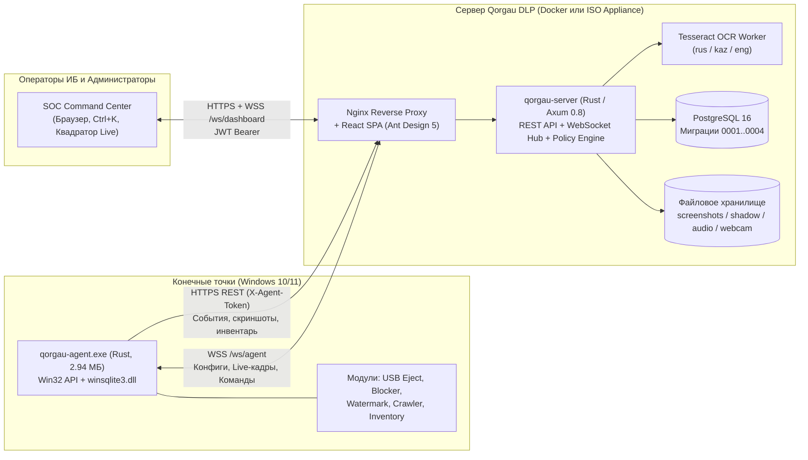

# 🏗️ Архитектура системы

← [[00 — Главная (MOC)]] | Далее: [[02 — Установка и ISO Appliance]]

## Общая схема взаимодействия

---

## Структура монорепозитория (Cargo Workspace)

| Путь | Назначение |
|---|---|
| `crates/qorgau-common/` | Общие DTO (`AgentConfigDto`, `PreventionRulesDto`, `WsAgentCommand`), встроенный движок DLP (ИИН с контрольной цифрой, БИН, Luhn для карт, IBAN `KZ...`, грифы ДСП/КТ). |
| `crates/qorgau-server/` | HTTP/WS сервер на Axum 0.8 + SQLx + Argon2 + JWT + SHA-256 хэш-цепочка аудита + экспорт CSV/JSON/XLSX (`rust_xlsxwriter`). |
| `crates/qorgau-agent/` | Нативный Windows-агент без зависимостей (.NET/Python не нужны). |
| `dashboard/` | Веб-консоль SOC на React 18, TypeScript, Vite, Ant Design 5, Recharts, TanStack Query. |
| `iso/` | Полностью воспроизводимый Docker-сборщик загрузочного оффлайн Debian 12 Appliance ISO. |
| `legacy/` | Архив старой Python-реализации (исключён из сборки). |

---

## Преимущества архитектуры Rust v2.0 перед Legacy Python

| Критерий | Legacy Python (v1) | Qorgau DLP v2.0 (Rust) |
|---|---|---|
| Число контейнеров | 7 (FastAPI, Celery, Beat, Redis, Postgres, Nginx, Grafana) | **3** (`db`, `server`, `nginx`) |
| RAM сервера | ~450–700 МБ | **~24 МБ** |
| Размер агента | ~45 МБ (PyInstaller + Python) | **2.94 МБ** (1 нативный `.exe`) |
| RAM агента на ПК | ~85–140 МБ | **~6.6 МБ** Private RAM |
| SQLite браузеров | Внешняя сборка `sqlite3` | Нативная `C:\Windows\System32\winsqlite3.dll` |
| Доставка политик | Опрос раз в 60 сек | Мгновенный push по WebSocket `/ws/agent` |

---

## Инварианты безопасности

> [!warning] Строгие правила безопасности (не нарушать при доработках)
> 1. `mod_microphone` и `mod_webcam` всегда **fail-closed (`false`)** по умолчанию (см. [[07 — Отчёты и комплаенс РК]]).
> 2. Все маршруты `/ws/agent` и `/ws/dashboard` защищены аутентификацией (`X-Agent-Token` / JWT).
> 3. Идентификатор `agent_id` валидируется против Path Traversal (`validate_agent_id`).
> 4. Журнал аудита защищён криптографической SHA-256 хэш-цепочкой (`prev_hash` → `entry_hash`).
